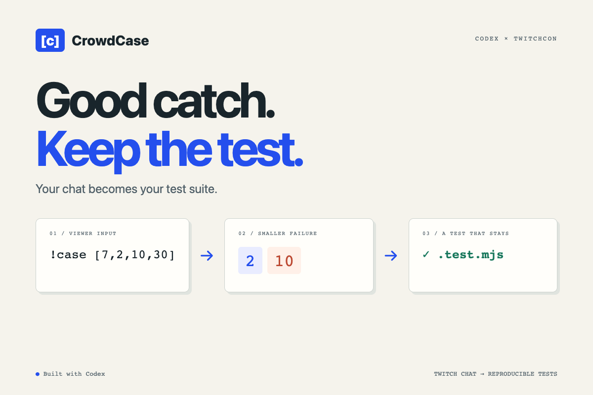
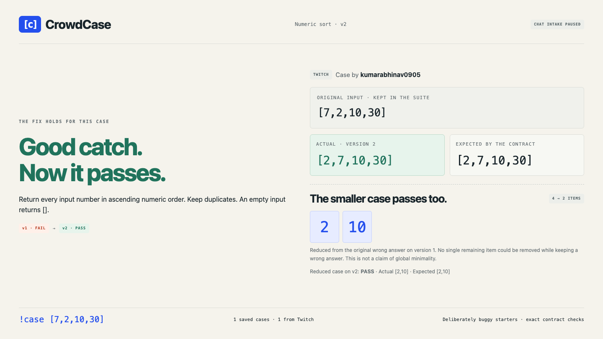

# CrowdCase



**Good catch. Keep the test.**

CrowdCase turns a coding stream's Twitch chat into a regression suite. A viewer sends an input, the app checks the streamer's function against a stated contract, and a reducer looks for a smaller example of the same wrong answer. The streamer fixes the function and keeps both examples as runnable tests.

[App](https://crowdcase.abhinav-0905.chatgpt.site) · [Source](https://github.com/Abhinav0905/crowdcase-twitchcon)

## The problem

"Try it with two-digit numbers." A useful suggestion can disappear into chat before anyone checks it. Even when it exposes a bug, the stream often ends without a test that reproduces it.

## How we solve it

1. A viewer sends `!case [7,2,10,30]` in the connected Twitch channel.
2. The numeric-sort starter returns `[10,2,30,7]`. The contract expects `[2,7,10,30]`.
3. CrowdCase removes unnecessary items. `[2,10]` still fails.
4. The streamer edits the function and reruns the suite. Both the original and reduced case must pass.
5. Download the function, Node regression tests and a JSON case record with contributor credit and implementation history.

## What we built

- Two explicit contracts: numeric ascending sort and second-highest distinct score.
- Read-only Twitch IRC over WebSocket, with channel confirmation, message IDs, timestamps, intake pause, deduplication and bounded queues.
- Browser worker running QuickJS WebAssembly. Each execution receives a fresh runtime/context with time, heap, stack and output limits.
- A bounded deletion reducer that preserves wrong answers. Exceptions and timeouts never count as smaller counterexamples.
- A stream display with a local HTTP/SSE host for OBS, plus same-browser synchronization in the hosted preview.
- Downloadable `.test.mjs`, `solve.mjs` and JSON records. Practice contributions and Twitch contributions retain separate labels.

No runtime language model or API key is required. Codex helped research, build and test the project. QuickJS executes the function; the selected contract supplies the expected answer.

## Run locally

Use Node.js 22 or later. This build was checked on Node 26.6.0 and Chrome on macOS.

```sh
npm ci
npm run build
npm start
```

Open **http://127.0.0.1:8782**. The workbench is ready without a Twitch account: send the prefilled practice case, inspect the reduction, load the example fix, then click **Apply & rerun suite**.

For real chat, enter a Twitch channel name and click **Connect Twitch**. Once it says `Reading #channel`, a logged-in viewer sends `!case [7,2,10,30]` in that channel's chat. CrowdCase reads messages and sends no chat replies. Changing the challenge pauses intake until the host reopens it.

Use the connection log to diagnose missing cases. Input must be a JSON array of at most 24 integers between -999 and 999. A viewer's contributions are rate-limited to one every 2.5 seconds. There are at most 12 queued requests and 50 saved case files per challenge.

## Stream display / OBS

When running the local server, click **Stream display** and paste its URL into an OBS Browser Source at **1440 x 810**. The random room URL is read-only; only the host session holds its write key. Keep the host tab and local server open. Rooms are memory-only and expire after six hours without updates.

The hosted static app synchronizes display tabs in the **same browser profile**. A separate OBS process cannot receive that browser's BroadcastChannel messages. Use the local server for OBS, or capture the hosted display window. This distinction is shown in the app's display dialog.

## Run the exported tests

Download both **regression tests** and **current function** into the same directory, then run:

```sh
node --test crowdcase.test.mjs
```

The original failing function should fail the exported tests; the provided corrected function passes. The JSON record keeps the original input, reduction, first/current results, code versions and contribution source.

## Verification

```sh
npm test
npm run test:browser
```

On macOS the browser suite uses installed Google Chrome. On Linux, run `npx playwright install chromium --with-deps` first. The checked build has **17 Node tests and 6 browser scenarios**. See [validation notes](docs/validation.md) for what those checks establish.

A real message from `kumarabhinav0905` reached the app on November 2, 2026, at 17:14 UTC. It produced the expected wrong answer, reduced to `[2,10]` and reached a separate browser display. This was a one-person integration check, not a public audience study or live broadcast.



The display above reopens the verified Twitch case after applying the fix. Intake is paused.

## Limits and data

- This is a prototype for two contracts and synchronous JavaScript functions, not an arbitrary repository test service.
- The starter bugs are deliberate demonstration fixtures. Passing a finite suite does not prove correctness.
- The reducer is bounded and deletion-based. It does not promise a globally smallest input.
- Viewers submit numbers, never executable code. Streamer code has no exposed browser, filesystem or network APIs inside QuickJS. The sandbox has not received an independent security audit.
- State stays in browser local storage. Local display snapshots live in the host process. Twitch receives the channel connection. There is no analytics service or server-side user database.
- Exported case records include contributor display names and message identifiers. Share those records deliberately. **Clear this challenge** removes its local cases.
- Twitch/network availability can interrupt intake. The UI pauses and requires reconnection; there is no hidden fallback that turns practice data into real chat.

## Build notes

[Architecture](docs/architecture.md) · [Codex process](docs/codex-process.md) · [Third-party notices](THIRD_PARTY_NOTICES.md)

MIT license. Built for the Codex x TwitchCon Hackathon, 2026.
