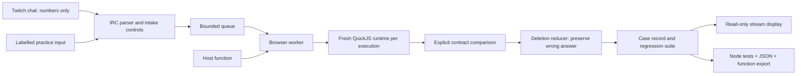

# Architecture

## Execution boundary

`src/runner.js` creates a fresh QuickJS runtime and context for each input. The WebAssembly module is reused, but guest globals are not. No host function or module loader is provided. The runtime limits heap memory to 8 MiB, stack to 256 KiB and execution to 75 ms. The parent browser terminates a worker request after 12 seconds if it stops responding.

Trusted output validation is installed before the guest function. Captured intrinsics inspect data properties without invoking output getters or `toJSON`. Only null, an in-range integer, or an array of at most 24 in-range integers can leave the guest. Promises, cycles, accessors and nonfinite numbers are rejected. This is risk reduction for a prototype, not a claim of perfect isolation.

## Contract and reduction

`src/contracts.js` owns the input bounds and deterministic reference implementations. A result is one of `pass`, `fail` (wrong answer), or `error` (execution/unsupported output). The reducer considers single-item deletions, retaining only wrong-answer candidates. It stops when no single deletion preserves a wrong answer, after 64 checks, or after 1.5 seconds. It reports budget exhaustion rather than claiming minimality.

Every reduced input stays attached to the original contribution. Applying a new function reruns both. A case file passes only if all its saved checks pass; an overfit fix that handles the original and fails the reduction stays unresolved.

## Twitch intake

`src/twitch.js` makes an anonymous, read-only IRC WebSocket connection. It requests tags/commands, confirms channel membership and answers protocol PINGs. It never emits a PRIVMSG. Only a tagged `!case` command in the chosen channel reaches intake. The app tracks message IDs, timestamp freshness, per-viewer rate limits and queue size. A channel disconnect pauses intake. Stored contribution source is never inferred from display text.

## Persistence and exports

Each contract has its own browser-local workspace. Applied source versions and before/after results are retained in a JSON export. Matching inputs share a case file but keep distinct contributor/source credits. Generated Node tests contain numeric JSON data and import the downloaded `solve.mjs`; chat text is never interpolated as executable test code.

## Display transports

Static hosting uses BroadcastChannel plus a last-known local snapshot. That works in the same browser profile. The optional Node host uses memory-only rooms, SSE readers and a random write credential held by the workbench. It binds to loopback. The room URL has no write capability. The display marks itself stale after 16 seconds without host updates.
